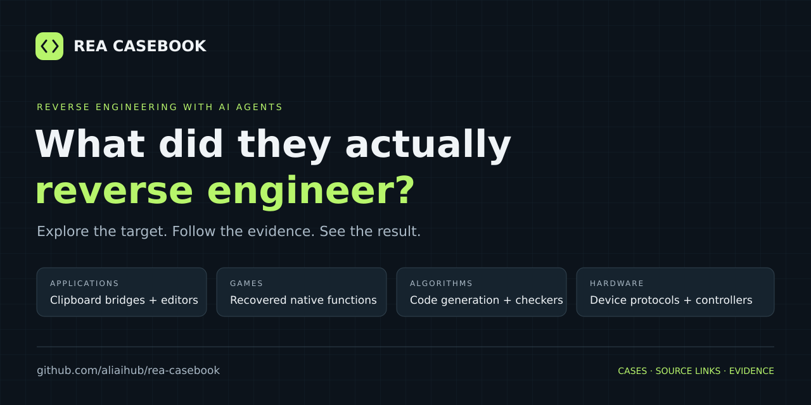

  

# REA Casebook

**Real-world reverse engineering with AI agents. Cases, code, demos, and evidence.**

From Notion’s clipboard bridge to recovered game logic, independent video editors, and device protocols: explore what people have investigated and built using [REA — Reverse Engineer Anything](https://github.com/morluto/rea).

**16 cases · 4 categories · Latest case review October 17, 2026**

[Applications](#applications) · [Games](#games) · [Algorithms](#algorithms) · [Hardware](#hardware) · [Submit a case](CONTRIBUTING.md)

## Start here

- **See a substantial implementation:** [Ledger Reborn](cases/ledger-reborn.md), an independent desktop accounting preview.
- **Study a tightly checked reconstruction:** [DX-Ball](cases/dx-ball.md), recovering a particular audio calculation.
- **Understand an everyday feature:** [Notion clipboard](cases/notion-clipboard.md), following an Electron API across process boundaries.
- **Explore a practical developer tool:** [zee-rp](cases/zee-rp.md), scoped reading and editing of Axure documents.

## Applications

| Case | What it covers | Evidence | Stage |
| --- | --- | --- | --- |
| [Notion: tracing the Electron clipboard bridge](cases/notion-clipboard.md) | Trace how the packaged desktop application copies text, HTML, and rich block information. | Official documented case | Analysis |
| [Ledger Reborn: an independent desktop accounting implementation](cases/ledger-reborn.md)  | Study QuickBooks Desktop for Mac workflows and implement an independent local accounting application. | Public project | Working implementation |
| [ReaCut: a video editor informed by CapCut research](cases/reacut.md)  | Use REA-assisted local behavior and format research to build an independent video editor. | Public project | Working implementation |
| [zee-rp: making Axure prototype files scriptable](cases/zee-rp.md)  | Read and edit supported Axure RP 11 documents through scripts and an MCP interface. | Public project | Working implementation |
| [Screen Studio: a reported recording-tool rebuild](cases/screen-studio.md) | Investigate a screen-recording application and implement a version from the recovered behavior. | Author report | Partial reconstruction |
| [MarkText: a reported HTML export reconstruction](cases/marktext-export.md) | Trace and reconstruct HTML export behavior from a built MarkText application. | Author report | In progress |
| [Wispr Flow: a documented local dictation reconstruction](cases/wispr-flow.md)  | Investigate dictation and paste behavior, then implement a limited local workflow with published test receipts. | Public project | Partial reconstruction |
| [Codex exec: a reconstruction experiment with a public test kit](cases/codex-exec-experiment.md)  | Study a bounded non-interactive CLI reconstruction using published differential tests and research notes. | Author report with public test artifacts | Partial reconstruction |
| [Virtual Desktop: implementing a Linux compatibility layer](cases/vd-streamer-linux.md)  | Analyze official streamers and replace platform-specific components with a Linux implementation. | Public project | Working implementation |

## Games

| Case | What it covers | Evidence | Stage |
| --- | --- | --- | --- |
| [DX-Ball: recovering positional audio](cases/dx-ball.md)  | Recover the position-to-pan calculation in DX-Ball 1.07. | Official documented case | Partial reconstruction |
| [Touhou TH04: reconstructing bullet-ring angles](cases/th04.md)  | Understand the fixed and aimed angle calculation in the PC-98 DOS game Lotus Land Story. | Official documented case | Partial reconstruction |
| [Warhammer III: save editing informed by native serializers](cases/wh3-save-editor.md)  | Recover save-format behavior to fix campaign conversion and support unit creation. | Public project | Working implementation |
| [Snowball War: reconstructing a DOS minigame in Rust](cases/snowball-war.md)  | Recover Ski or Die's Snowball War rules and implement one playable minigame in Rust/SDL2. | Public project | Partial reconstruction |

## Algorithms

| Case | What it covers | Evidence | Stage |
| --- | --- | --- | --- |
| [Aegis: understanding one-time code generation](cases/aegis-totp.md) | Locate the one-time-code calculation in a released Android APK. | Official documented case | Analysis |
| [DownUnderCTF: solving a flag checker](cases/ctf-checker.md) | Determine which input satisfies a native CTF checking program. | Official documented case | Analysis |

## Hardware

| Case | What it covers | Evidence | Stage |
| --- | --- | --- | --- |
| [Smart-home Bluetooth: a reported Mac controller](cases/smart-home-bluetooth.md) | Control a personally owned smart toilet from a desktop menu-bar application. | Author report | Working implementation |

## Reading the evidence

Star badges show interest in the linked implementation or research project, not the original software. Stars are a discovery signal, not proof of accuracy or REA involvement; projects are selected for evidence and usefulness, with no minimum star count.

| Label | Meaning |
| --- | --- |
| Official documented case | Published by REA with an investigation or worked example; validation belongs to the source |
| Public project | Public implementation and documentation; availability does not establish correctness or parity |
| Author report with public test artifacts | A reported result with inspectable test code or receipts; the implementation may be unavailable and results are not independently reproduced |
| Author report | A reported result, sometimes discovered through a secondary collection; source-access limitations are stated |
| Independently reproduced | Reserved for a documented reproduction by a casebook reviewer; no launch entry has this status |

Stage describes the kind of result, not its verification level. **Working implementation** means the source describes working software, not that we have run or endorsed it. A recovered function, a feature investigation, and a complete application are different scopes. Case pages state which applies.

## Scope

This collection covers concrete REA-assisted investigations and implementations. We prioritize public artifacts and precise results, and retain selected author reports with explicit limits. Tool installations, generic AI clones without REA attribution, and unrealized ideas do not count as cases.

The launch collection is a documentation review. We have not run the listed software or independently reproduced its test claims. Links and project capabilities can change after the review date.

## Contribute

**Built something with REA? [Add your case](https://github.com/aliaihub/rea-casebook/issues/new?template=case.md).** Include a target, a result, and the source or evidence that supports it.

Found something worth documenting? [Submit a case](https://github.com/aliaihub/rea-casebook/issues/new?template=case.md) or send a pull request using the [contribution guide](CONTRIBUTING.md) and [case template](cases/TEMPLATE.md). Corrections and stronger evidence are especially welcome.

## Sources and acknowledgments

- [REA](https://github.com/morluto/rea) and its [official case studies](https://rea.tools/showcase/) provide foundational examples.
- [Awesome REA Cases](https://github.com/songshikang0111/awesome-REA-cases) helped discover community cases. Our summaries are independently written, with discovery attribution on the relevant pages.
- [REA Gems](https://github.com/sqwu/rea-gems) is another community discovery resource.

This is an unofficial community project, unaffiliated with the REA team or the software vendors named here. Original research, code, and demonstrations belong to their respective authors.

## License and responsible use

Original casebook text and repository scaffolding use the [MIT License](LICENSE). Linked projects, software, and assets retain their own licenses. The casebook distributes summaries and links, not third-party software, credentials, or proprietary assets. Confirm the relevant authorization before reproducing an investigation.
